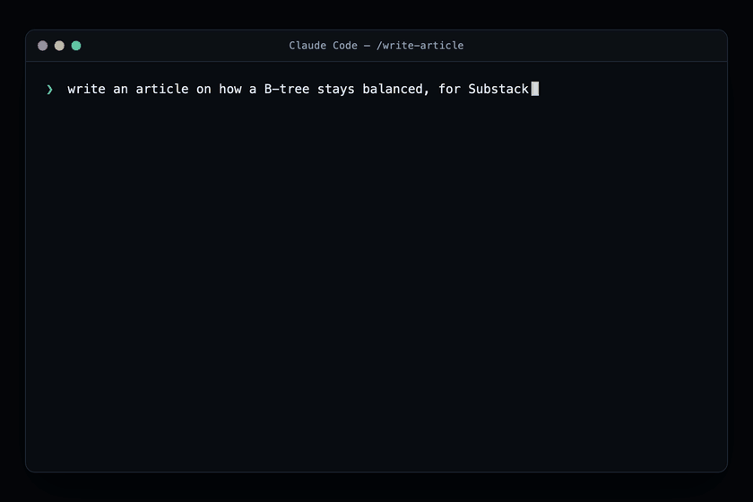

# write-article

A [Claude Code](https://claude.com/claude-code) skill that takes a technical article from idea to a publishable bundle: spec, prose, diagrams, banner, and title, with every asset generated, rendered, and reviewed before you see it.



Two asset lanes, chosen per diagram by one mechanical rule:

- **HTML lane** — anything carrying verbatim code, IR, instruction names, or exact numbers is authored as fixed-size HTML in a dark "Slate" house style and rendered to a 2× PNG through headless Chrome. Pixel-exact text, always.
- **Image lane** — the banner and concept diagrams are generated with **gpt-image-2 through the codex CLI**, using a committed house look from a five-look aesthetic library so nothing lands on the generic neon-card attractor.

The pipeline has one human gate (spec approval, skipped when your request already contains thesis and audience) and ends with a mandatory three-pass review: full read-through, a voice/[humanizer](https://github.com/blader/humanizer) audit, and a publishing checklist.

## Requirements

| Tool | Used for | If missing |
| --- | --- | --- |
| [Claude Code](https://claude.com/claude-code) | runs the skill | required |
| [codex CLI](https://github.com/openai/codex), authenticated, with built-in gpt-image-2 (ships with Codex plans) | image lane | prompts saved, assets marked **pending**, pipeline still completes |
| Google Chrome / Chromium / Edge | HTML diagram rendering | HTML lane fails; set `CHROME_BIN` to override the binary path |
| `python3` | extracting image bytes, reading PNG sizes | required for the image lane |
| [humanizer](https://github.com/blader/humanizer) skill (`npx skills add blader/humanizer`) | review-phase voice audit | falls back to the built-in `voice.md` checklist |

The skill never silently downgrades an image-lane asset to another medium: if codex is unavailable, the prompt is kept and the asset is flagged pending.

## Install

Full walkthrough in [INSTALL.md](INSTALL.md), including prerequisites and a smoke test.

### As a plugin

```text
/plugin marketplace add philip-bankiers-helper/write-article-skill
/plugin install write-article@write-article-skill
```

Start a new session so the skill list refreshes.

### By copying the skill folder

```bash
git clone https://github.com/philip-bankiers-helper/write-article-skill.git
cp -R write-article-skill/skills/write-article ~/.claude/skills/
```

Or symlink instead of copy so updates are a plain `git pull`:

```bash
ln -s "$(pwd)/write-article-skill/skills/write-article" ~/.claude/skills/write-article
```

## Verify

In a new session, ask: *"what are your article writing phases?"* — it should recite the eight phases (intake, ground, spec, prose, diagrams, banner and title, review, package).

## Use

```text
write an article about <idea>, grounded in <repo or files>, for <platform>
```

Give it thesis and audience up front and it skips the spec gate and runs straight through. Partial entry works too: "make the diagrams for this draft", "review this article", "redo the banner".

Everything for one article lands in a self-contained folder in *your* project (never in this repo):

```
articles/<slug>/
  spec.md
  article.md                 ← the deliverable
  assets/
    01-<name>.html / .png    ← HTML lane (source + 2× render)
    02-<name>-prompt.md / .png  ← image lane (prompt kept for re-rolls)
    banner-prompt.md / banner.png
```

## Permissions

The skill runs the codex CLI and headless Chrome via its two `scripts/`, and reads/writes files in your project. Claude Code will prompt for these the first time. To reduce prompts, allow the script invocations and the codex/Chrome commands in your project or user settings, or add an `allowed-tools` line to the skill's frontmatter for your own install.

## Layout

```
write-article-skill/
  .claude-plugin/
    plugin.json              ← plugin manifest (marketplace install)
    marketplace.json         ← marketplace catalog
  skills/write-article/
    SKILL.md                 ← the pipeline: 8 phases, lane rule, gates
    references/
      voice.md               ← generative voice canon (wins over humanizer on conflict)
      html-diagrams.md       ← Slate house style, render + read-back loop
      image-craft.md         ← gpt-image-2 craft system: 5 house looks, prompt format, lever policy
    scripts/
      render-html.sh         ← headless Chrome, 2× device scale
      generate-image.sh      ← codex exec render lane (extracts bytes from the session log)
  INSTALL.md               ← install, prerequisites, smoke test
  README.md
  LICENSE
```

Scripts are referenced from `SKILL.md` via `${CLAUDE_SKILL_DIR}` so they resolve whether the skill is installed by copy, symlink, or plugin cache.

## Troubleshooting

- **"codex CLI not found" / assets marked pending** — install and authenticate the codex CLI; confirm `codex exec` works and your plan includes gpt-image-2.
- **"no Chrome/Chromium/Edge found"** — install a Chromium-family browser, or set `CHROME_BIN=/path/to/chrome`.
- **A generated image has invented or wrong text** — expected occasionally; the skill's read-back catches it and re-runs the image as an edit (not a re-roll) to strip it. See `references/image-craft.md`.
- **Shell execution disabled by policy** — some managed environments disable skill shell execution; the script-driven lanes won't run there.

## Status

Pre-release, shared for feedback. Verified end to end on macOS: grounding, spec gate, prose, both asset lanes, and the three-pass review, including the edit-retry that fixes a bad image without a full re-roll. Not yet verified: Linux, and the `/plugin marketplace add` round-trip from a clean machine — folder-copy is the safe install path.

Feedback worth sending back: whether the spec gate fires when it should and skips cleanly when your request already has thesis and audience, whether the HTML-vs-image lane routing picks the right lane per diagram, whether the prose reads like a person wrote it, and any install friction.

Maintainer notes (repo visibility, pre-public checklist) are in [PRERELEASE.md](PRERELEASE.md).

## Credits

The gpt-image-2 craft system is adapted from the visual-craft rework of [philipbankier/codex-image-skill](https://github.com/philipbankier/codex-image-skill). The review-phase voice audit integrates [blader/humanizer](https://github.com/blader/humanizer).
